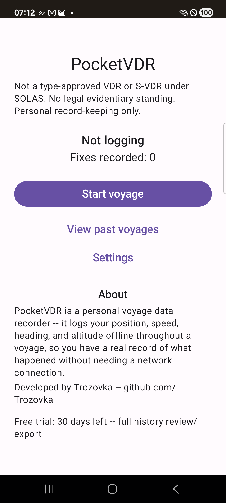
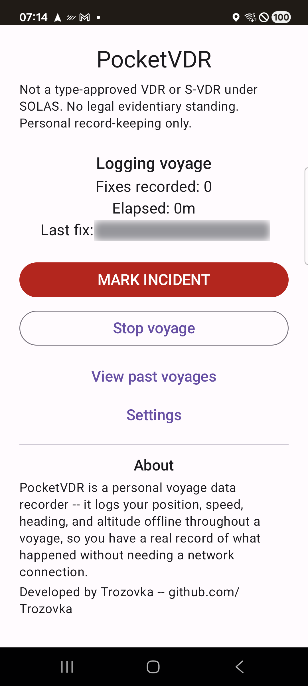
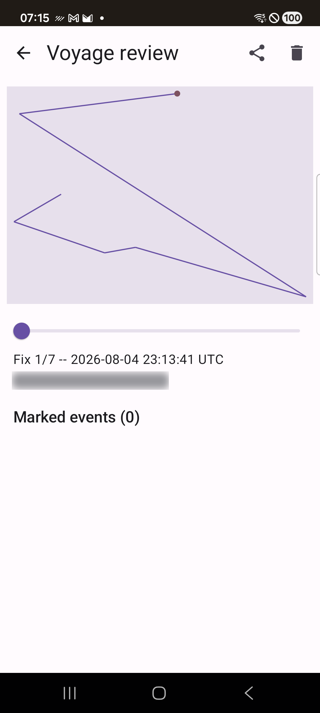

# PocketVDR Free

A personal voyage data recorder on your Android phone. It records position, time, speed, heading and
altitude for the whole voyage, using only the phone's GPS. No internet, no account.

Use it for your own record: what happened before an incident, proof of your track for insurance, checking a
passage afterwards, or simply knowing what really happened instead of relying on memory.

**PocketVDR is not a type-approved VDR or S-VDR under SOLAS and has no legal standing as evidence.** It is a
personal record-keeping tool only, not a replacement for certified equipment.

**Recording never needs internet.** The free version does not even ask for internet permission, so it keeps
working far out of signal range.

Made by **[Trozovka](https://github.com/Trozovka) (John Winsome Munar)**, Master Mariner.

Keywords: voyage data recorder, VDR, track log, GPS logger, GPX, NMEA, offline, Android, ship, seafarers, incident record, OpenCPN.

## Screenshots

| Idle | Recording | Review |
|---|---|---|
|  |  |  |

## What it does

- Records position, UTC time, speed, heading, altitude and satellites used, every 7 seconds
  (5 to 60 seconds in Settings).
- Keeps recording with the screen locked (after you allow the battery exemption).
- While recording: number of fixes, voyage time, satellites and current position.
- A big **Mark Incident** button: tags the current position and time, with an optional short note
  (near miss, weather, engine trouble), easy to find later.
- Start and stop voyages; a list of past voyages to reopen or delete.
- Review screen: your track drawn on a simple offline plot, a timeline slider, and a list of marked events.
- Positions shown as `xx.xxxxx N/S, yyy.yyyyy E/W`.
- Export any time range (or the whole voyage) as GPX or NMEA 0183 (for OpenCPN, Google Earth, chart
  plotters) or as a plain text log anyone can open in Notepad (for an insurer or surveyor).
- First 30 days: full review and export of all history. After that recording stays unlimited forever;
  review and export cover the last 24 hours or the current voyage. Pro removes that limit.

## Install (no building needed)

Coming soon to Google Play. Until then, install the APK:

1. Download it from **[GitHub Releases](https://github.com/Trozovka/pocketvdr-free/releases)** or
   **[Gumroad](https://trozovka.gumroad.com/l/pocketvdr-free)** (free).
2. Open it on the phone. Android asks you to allow installs from this source the first time. That is normal
   for apps installed outside Google Play.
3. Open the app, allow location, allow the battery exemption, and tap **Start voyage**.

## Pro version

**PocketVDR Pro** lets you review and export every voyage you ever recorded, not only the last 24 hours.
Price and download: **[trozovka.gumroad.com/l/pocketvdr-pro](https://trozovka.gumroad.com/l/pocketvdr-pro)**.
The Pro source is private. This repo has the full source of the free version under the MIT license.

---

## For developers

### Technical details

- Location from `FusedLocationProviderClient` with a `LocationManager` fallback, plus a live `GnssStatus`
  satellite count.
- Android foreground service with a partial wake lock; survives Doze once the battery-optimization exemption is granted.
- The 30-day trial is tracked locally (no account). The free manifest has no `INTERNET` permission.

### Why no map tiles

The review "map" is a plain Compose Canvas plot of the raw lat/lon points, not a basemap. A tile map
(e.g. osmdroid's online tiles) needs the network, and this project only lets the network matter for licensing,
once. So the review screen stays fully offline, at the cost of no coastlines under the track.

### Build from source

Requires JDK 17 and the Android SDK (the Gradle wrapper handles the rest).

```
git clone --recurse-submodules https://github.com/Trozovka/pocketvdr-free.git
cd pocketvdr-free
echo "sdk.dir=/path/to/your/android-sdk" > local.properties
./gradlew assembleDebug
adb install app/build/outputs/apk/debug/app-debug.apk
```

### Tech stack

- Kotlin + Jetpack Compose, MVVM.
- Gradle multi-module: `:core` (logging service, SQLite via Room, GPX/NMEA export, entitlement logic, all UI;
  shared with Pro) + `:app` (thin Free launcher). Internal package names still say `lite`; they are kept so
  existing installs keep updating.
- The foreground-service/wake-lock/battery-exemption pattern and the Gumroad licence pattern come from
  [trozovka-android-toolkit](https://github.com/Trozovka/trozovka-android-toolkit) as a git submodule, shared with
  [GPS Server for OpenCPN](https://github.com/Trozovka/gps-server-for-opencpn-free).
- minSdk 26, target latest stable Android API.
- Not a fork. The closest existing app (BasicAirData/GPSLogger) is GPL-3.0, which would force the private Pro
  source open, and does not have the incident/voyage/export model, so this was built from scratch.

## License

MIT -- see [LICENSE](LICENSE) for the full text.

Copyright (c) 2026 Trozovka (John Winsome Munar). Original Author: Trozovka (John Winsome Munar). All derivative works must retain the
[NOTICE](NOTICE) file's attribution. Not a fork of, or derived from, any other project's source.
